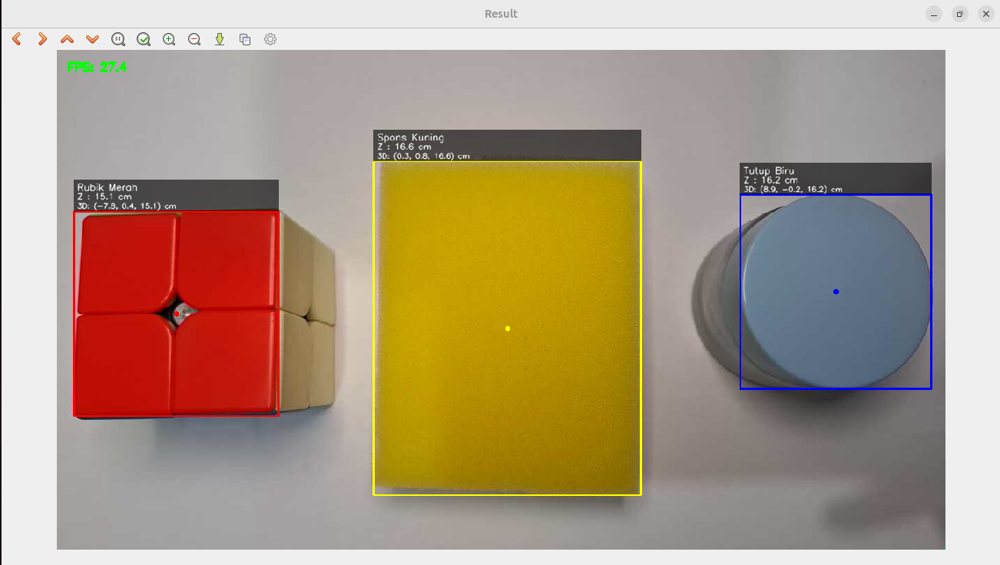
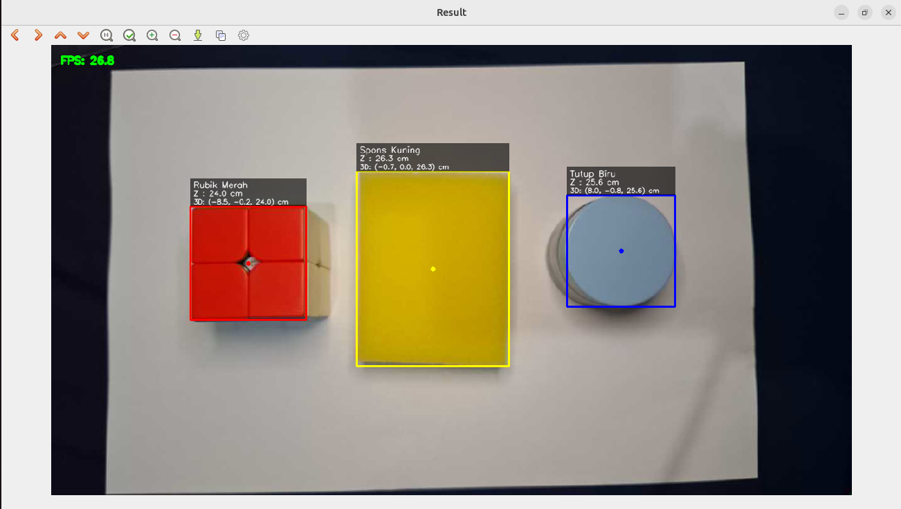

# KPP Week 2 OpenCV

Nama Lengkap: Siti Aisyah  
NRP: 5027261044

## Deskripsi singkat:
Program C++ berbasis OpenCV untuk kalibrasi kamera dan object detection. Program ini akan melacak objek berwarna kuning, merah, dan biru lalu menentukan estimasi koordinat 3D (X, Y, Z). Saya menggunakan IP Webcam dari HP yang terhubung dengan IP address.


## Analisis Singkat
### 1. Alur Pemrosesan

```
Frame BGR → HLS → inRange (per objek) → erode/dilate → findContours
→ kontur terbesar → bounding box + centroid → Z, X, Y → HUD
```

### 2. Hasil Kalibrasi

| Parameter | Nilai |
|---|---|
| Kamera | IP Webcam |
| Jumlah foto kalibrasi | 15 |
| Papan catur | 9 x 6 sudut, sisi kotak 2,5 cm |
| f_x | 891.59 |
| f_y | 891.338 |
| c_x | 632.398 |
| c_y | 357.405 |
| RMS | 0.378962 |

### 3. Data Objek
Program ini menggunakan 3 objek yang saya pilih dengan detail sebagai berikut:
| Objek | Warna | W_real | H min/max | L min/max | S min/max |
| ----- | ----- |------ | --------- | --------- | --------- |
| Spons | Kuning | 7.2 | 22/36 | 4/195 | 89/255 |
| Rubik | Merah | 5.0 | 0/10 | 57/172 | 70/255 |
| Tutup Moist | Biru | 5.0 | 96/128 | 73/176 | 21/255 |  

### 4. Hasil Deteksi
Pada jarak ± 20 cm dari kamera:
  
Pada jarak ± 30 cm dari kamera:



## Kendala
1. Rentang Hue pada awalnya saling menimpa. Solusinya adalah dengan mengatur H min dan H max nya.
2. Frame IP stream tertunda, karena itu saya memakai grab() untuk membuang antrean.
3. Rumus X dan Y agak keliru di file KPP. Setelah di crosscheck variabel fx seharusnya dibagi, bukan dikali.
4. Noise dan pemilihan iterasi erode dilate. Akhirnya saya atur lagi HLS nya agar noise lebih sedikit dan mencari pencahayaan terbaik.
5. Tulisan di bounding box tidak terlalu kelihatan. Akhirnya saya tambahkan box hitam transparan agar tulisan lebih jelas.
6. Jendela default ubuntu saya terlalu besar. Saya menggunakan namedWindow() agar ukurannya pas.
7. Karena bingung menentukan rentang HLS. Jadinya saya menggunakan trackbar warna dengan bantuan AI.


## Cara Penggunaan

### 1. Prasyarat
- Ubuntu/Linux
- OpenCV 4 untuk C++
- CMake (versi 3.10 atau lebih baru) dan compiler C++17 (g++)
- Kamera (webcam/IP webcam) dan papan catur untuk kalibrasi

### 2. Clone dan Build
```bash
git clone https://github.com/Aishyaae/IRIS-internship.git
cd kpp-opencv

cmake -S . -B build
cmake --build build
```

Hasil build: `build/calib` (kalibrasi) dan `build/program` (tracker).

> **Penting:** jalankan semua program dari **folder utama proyek** (bukan dari dalam `build/`), karena program membaca dan menulis `yaml/kalibrasi.yaml` memakai path relatif.

### 3. Kalibrasi Kamera (sekali saja)
1. Cetak papan catur pada skala 100%, tempel di permukaan rata, lalu ukur sisi satu kotak. Nilai ini diisi ke `squareSize` di `calib.cpp`. Papan yang dipakai memiliki **9 × 6 sudut dalam**, sisi kotak **2,5 cm**.
2. Jalankan:
   ```bash
   ./build/calib
   ```
3. Arahkan papan ke kamera sampai garis warna deteksi sudut muncul.
4. Tekan **`Spasi`** untuk menyimpan satu pose (hanya tersimpan jika papan terdeteksi).
5. Ulangi hingga **15 foto** dengan variasi pose: dekat, jauh, miring, dan di pojok frame.
6. Setelah mencapai target, program otomatis menghitung kalibrasi dan menulis `yaml/kalibrasi.yaml`. Periksa nilai **RMS error**; di bawah ±0,5 tergolong baik.

Cek hasilnya:

```bash
cat yaml/kalibrasi.yaml
```

### 4. Menjalankan Tracker
```bash
./build/program
```

Program membaca `yaml/kalibrasi.yaml`, mendeteksi tiga objek (rubik merah, spons kuning, tutup biru), lalu menampilkan bounding box, centroid, jarak Z, dan koordinat (X, Y, Z) dalam cm.

Tips agar hasil akurat:
- Hadapkan sisi objek yang sudah diukur ke kamera (nilai `W_real` hanya valid untuk sisi itu).
- Gunakan pencahayaan yang mirip dengan saat pencarian rentang HLS.

### 5. Tombol Keyboard
| Program | Tombol | Fungsi |
|---|---|---|
| `calib` | `Spasi` | Simpan pose papan catur saat ini |
| `calib` | `q` | Keluar |
| `main` | `q` | Keluar |

